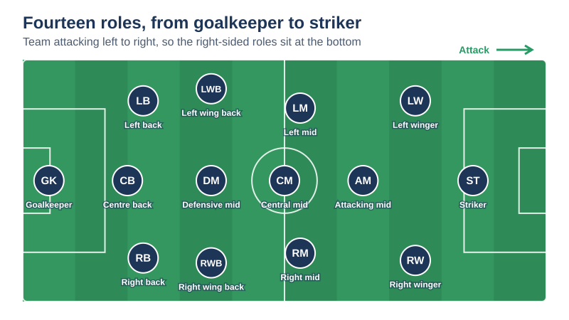

In player tables you can also hover over (or long-press) a header to see its full name.

## Player statistics

<dl class="wiki-glossary">
<dt>Nat</dt><dd>Nationality.</dd>
<dt>Pos</dt><dd>Main position, as a role code. See <a href="/wiki/player-positions">Player positions</a>.</dd>
<dt>SecPos</dt><dd>Secondary position. Blank when the player has no other regular role.</dd>
<dt>No.</dt><dd>Shirt number.</dd>
<dt>NPG</dt><dd>Non-penalty goals: goals scored excluding penalties.</dd>
<dt>GA/90</dt><dd>Goals plus assists per 90 minutes. Shown as GA90 on narrow screens.</dd>
<dt>Sub Apps</dt><dd>Appearances as a substitute.</dd>
<dt>Pens Won</dt><dd>Penalties won.</dd>
<dt>Pens Com.</dt><dd>Penalties committed (conceded).</dd>
<dt>Pens Saved</dt><dd>Penalties saved by a goalkeeper.</dd>
<dt>Drib. Succ</dt><dd>Successful dribbles.</dd>
<dt>Drib. Past</dt><dd>Times an opponent dribbled past the player.</dd>
<dt>Acc. Passes</dt><dd>Accurate passes.</dd>
<dt>Pass %</dt><dd>Pass accuracy: accurate passes as a share of all passes.</dd>
<dt>Interc.</dt><dd>Interceptions.</dd>
<dt>GC</dt><dd>Goals conceded.</dd>
</dl>

For the icon columns (goals, assists, minutes and so on), see [Player table icons](/wiki/player-stat-icons).

## Positions

<figure class="wiki-figure">

<figcaption>Where each role sits, with the team attacking to the right.</figcaption>
</figure>

<dl class="wiki-glossary">
<dt>GK</dt><dd>Goalkeeper.</dd>
<dt>RB</dt><dd>Right back.</dd>
<dt>CB</dt><dd>Centre back.</dd>
<dt>LB</dt><dd>Left back.</dd>
<dt>RWB</dt><dd>Right wing back.</dd>
<dt>LWB</dt><dd>Left wing back.</dd>
<dt>DM</dt><dd>Defensive midfielder.</dd>
<dt>CM</dt><dd>Central midfielder.</dd>
<dt>AM</dt><dd>Attacking midfielder.</dd>
<dt>RM</dt><dd>Right midfielder.</dd>
<dt>LM</dt><dd>Left midfielder.</dd>
<dt>RW</dt><dd>Right winger.</dd>
<dt>LW</dt><dd>Left winger.</dd>
<dt>ST</dt><dd>Striker.</dd>
<dt>DF</dt><dd>Defender, when no specific role is known yet.</dd>
<dt>MF</dt><dd>Midfielder, when no specific role is known yet.</dd>
<dt>FW</dt><dd>Forward, when no specific role is known yet.</dd>
</dl>

## League and team tables

<dl class="wiki-glossary">
<dt>P</dt><dd>Matches played.</dd>
<dt>W</dt><dd>Wins.</dd>
<dt>D</dt><dd>Draws.</dd>
<dt>L</dt><dd>Losses.</dd>
<dt>GD</dt><dd>Goal difference: goals scored minus goals conceded.</dd>
<dt>Pts</dt><dd>Points: 3 for a win, 1 for a draw.</dd>
<dt>For / Ag</dt><dd>For and against. Team tables split goals, expected goals and other stats into what a team produced and what it allowed.</dd>
<dt>Rtg</dt><dd>Rating. In a match lineup it is the player's rating; in league and team tables it is the <a href="/wiki/average-team-rating">average team rating</a>.</dd>
</dl>

## Expected statistics

<dl class="wiki-glossary">
<dt>xG</dt><dd>Expected goals: how many goals a team or player would normally score from the chances they had, based on the quality of each shot.</dd>
<dt>xGA</dt><dd>Expected goals against: the same measure for the chances a team allowed.</dd>
<dt>xGOT</dt><dd>Expected goals on target: expected goals from shots that hit the target, taking into account where in the goal they were placed.</dd>
<dt>xA</dt><dd>Expected assists: how likely a pass was to become an assist, based on the quality of the chance it created.</dd>
<dt>xPts</dt><dd>Expected points: how many points a team deserved from the chances in its matches. See <a href="/wiki/expected-points">Expected Points</a>.</dd>
</dl>
