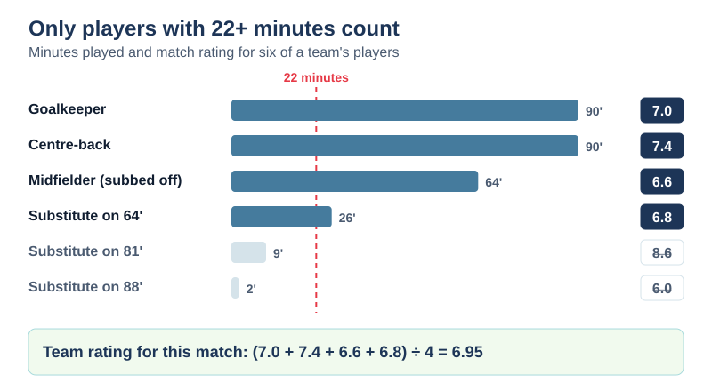
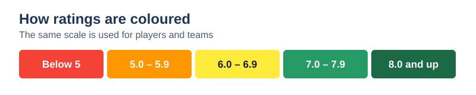

<h2>In short</h2>
<ul>
<li>For each match, we average the ratings of the players who played <strong>at least 22 minutes</strong>.</li>
<li>A team's rating for a competition is the average of its match ratings, with every match counting equally.</li>
<li>It appears as <abbr title="Rating">Rtg</abbr> in league tables and on team pages.</li>
</ul>

## How a match rating is calculated

Every player who features in a match gets a performance rating, usually somewhere between 5 and 9. To rate the team as a whole for that match, we average the ratings of the players who were on the pitch for **at least 22 minutes**.

The minutes rule keeps cameos from distorting the number. A substitute who comes on in the 88th minute and touches the ball twice can end up with an unusually high or low rating, and it would be wrong for that to move the whole team's score as much as a full 90 minutes from a starter.

<figure class="wiki-figure">

<figcaption>The substitute who came on for the last nine minutes and was rated 8.6 is left out, so a short bright spell can't lift the team's number.</figcaption>
</figure>

### When ratings are missing

Our main data source does not rate every match. When it has no player ratings for a game, we use FotMob's player ratings instead, with the same 22-minute rule. Matches with no ratings from either source are skipped rather than counted as zero.

## From matches to a season figure

A team's rating in a competition is the **average of its match ratings** in that competition. Every rated match counts the same, whether it was a 5–0 win or a 0–0 draw. The **overall** rating does the same across all of the team's matches in every competition.

## Reading the colours

Ratings are coloured the same way for teams and players:

<figure class="wiki-figure">

</figure>

Team averages sit much closer together than individual ratings, because good and bad performances within a side cancel each other out. That means even a few tenths of a point between two teams over a season is a meaningful gap.

## Where you'll see it on the site

- **League tables** show the rating in the <abbr title="Rating">Rtg</abbr> column, calculated from the matches counted in those standings.
- **Team pages** show the overall rating and a breakdown by competition.
- **[Top Teams](/top-teams)** shows it for the leagues you have selected.

## Good to know

Why is the team average on a match page different?

The average shown under a match lineup includes every player who has a rating, however few minutes they played. It describes that one lineup. The 22-minute rule only applies to the team ratings used in tables and on team pages.

Does a high team rating mean a team won?

Usually, but not always. Ratings reward individual performance, so a side can play well and still lose. For a measure built on chances rather than individual ratings, see <a href="/wiki/expected-points">Expected Points</a>.

