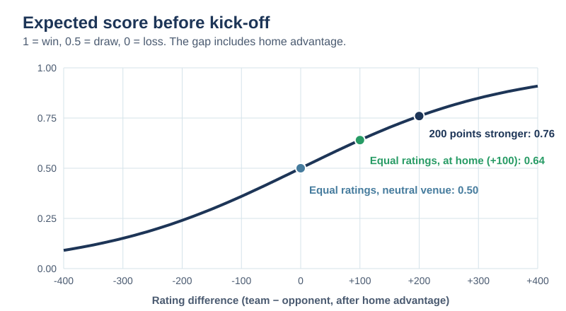
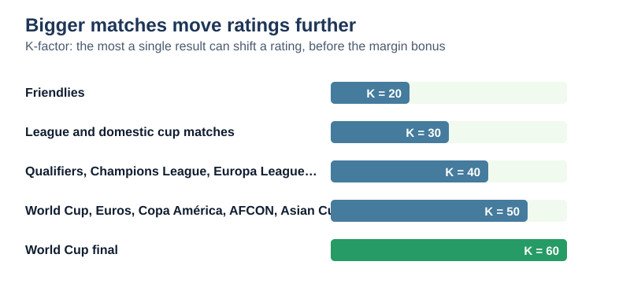
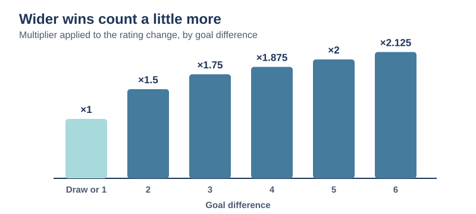

<h2>In short</h2>
<ul>
<li>Every team starts at <strong>1500</strong>, using matches from the last five seasons.</li>
<li>Before each match we work out each side's expected score. Home sides get a <strong>+100</strong> boost unless the venue is neutral.</li>
<li>After the match, ratings move by <code>K × margin × (actual − expected)</code>. Bigger matches and wider wins move them further.</li>
</ul>

## Clubs and national teams are rated separately

We keep two separate pools: one for **clubs** and one for **national teams**. A club's rating never mixes with its country's, and the rare matches between a club and a national team are left out. Every team enters its pool at a rating of **1500**, and ratings are built from results over the **last five seasons**.

## Step 1: the expected score

Before a match we compare the two ratings and work out each side's *expected score*. A win scores 1, a draw 0.5 and a loss 0, so the expected score is roughly "how many of those points we would expect this team to take". We use the classic Elo formula:

<code>expected = 1 ÷ (1 + 10(opponent rating − team rating) ÷ 400)</code>

The home side's rating gets **+100** before this comparison, to reflect home advantage. That boost is dropped on neutral ground. Neutral ground means fixtures flagged as neutral, the main tournaments (World Cup, Euros, Copa América, Africa Cup of Nations, Asian Cup, Club World Cup and the Super Cup), and the finals of the major club competitions.

<figure class="wiki-figure">

<figcaption>The bigger the rating gap, the more a team is expected to take from the match. Home advantage is worth the same as being 100 points stronger.</figcaption>
</figure>

## Step 2: score the result

After the final whistle the result is scored **1 for a win, 0.5 for a draw and 0 for a loss**. Matches settled on penalties use the score after extra time, so they count as draws.

## Step 3: update the ratings

The rating change is:

<code>change = K × margin multiplier × (actual result − expected result)</code>

The winner gains exactly what the loser drops, so the total of all ratings in a pool stays the same.

### K: how much a match matters

**K** sets how far a single result can move a rating. Friendlies move ratings the least and a World Cup final the most.

<figure class="wiki-figure">

<figcaption>Qualifiers, the Champions League, Europa League, Conference League, Copa Libertadores and other continental club competitions all use K = 40.</figcaption>
</figure>

### Margin: wider wins count a little more

A thrashing says more than a scrappy 1–0, but not unboundedly more. The change is multiplied by:

| Goal difference | Multiplier |
|---|---|
| Draw or 1 goal | 1 |
| 2 goals | 1.5 |
| 3 or more | (11 + goal difference) ÷ 8 |

<figure class="wiki-figure">

<figcaption>The multiplier grows quickly at first and then levels off, so running up the score has limited value.</figcaption>
</figure>

## A worked example

A home team rated **1600** hosts an away team rated **1500** in a league match (K = 30).

- With the home boost the gap is 200 points, so the home side's expected score is **0.76** and the away side's 0.24.
- **Home win 2–0:** 30 × 1.5 × (1 − 0.76) = **+10.8**. The home team rises to about 1611 and the away team drops to about 1489.
- **Draw 1–1:** 30 × 1 × (0.5 − 0.76) = **−7.8** for the home side. A draw at home against a weaker team costs rating points.
- **Away win 0–1:** 30 × 1 × (0 − 0.76) = **−22.8** for the home side and +22.8 for the away side. Upsets move ratings the most.

## Where you'll see it on the site

- [Top Teams](/top-teams) ranks teams by recent form and uses club Elo as the tie-breaker.
- Every team page shows the current rating and how it has moved over the last month.
- Match pages show both teams' ratings and how many points each side gained or lost from that fixture.

## Good to know

Why did my team lose rating points after a draw?

If a team was expected to take more than half the points, because it was rated higher, was at home, or both, then a draw is below expectation and the rating drops slightly. The opponent gains the same amount.

Can I compare a club's rating with a national team's?

No. The two pools are calculated separately and never play each other, so a club rated 1700 and a country rated 1700 are not on the same scale.

Is a newly added team's rating reliable?

Not straight away. Every team starts at 1500, so it takes a run of matches before a new team's rating settles where it belongs.

