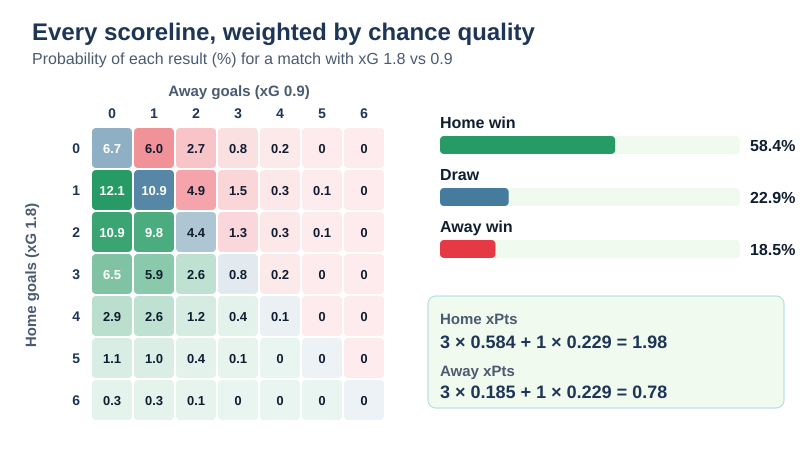

<h2>In short</h2>
<ul>
<li>xPts starts from each side's <strong>expected goals (xG)</strong> in a match.</li>
<li>A Poisson model turns those into the chance of a win, a draw and a loss.</li>
<li><code>xPts = 3 × win chance + 1 × draw chance</code>, so a single match is worth between 0 and 3 xPts.</li>
</ul>

## Why expected points?

Football results are noisy. A team can dominate a match, create the better chances and still lose 1–0 to a deflected shot. Over a few weeks that luck evens out, but a league table built only on points can hide it for a long time.

Expected points look past the scoreline. They ask: *given the chances each team actually created, how many points would this performance usually earn?* A side that keeps creating good chances will collect plenty of xPts even during a run of bad results, and a side that keeps winning narrow games on very little will show fewer xPts than real points.

## How it's calculated

We work out xPts for every match in three steps.

1. **Start with expected goals.** For each match we take the team's expected goals (xG) and the opponent's xG, which is the team's expected goals against (xGA). xG measures the quality of the chances a team had: a tap-in from two yards is worth far more than a shot from 35 metres.
2. **Turn xG into scorelines.** We treat each team's goals as a [Poisson distribution](https://en.wikipedia.org/wiki/Poisson_distribution) whose average is its xG, and assume the two teams score independently. That gives a probability for every scoreline from 0–0 up to 6–6. Scorelines beyond six goals for one side are so unlikely that we leave them out.
3. **Add up wins, draws and losses.** Every scoreline where the team scores more is a win, equal scores are a draw, and the rest are losses. Adding those probabilities gives the team's chance of each result.

<code>xPts = (win probability × 3) + (draw probability × 1)</code>

## A worked example

Say the home side finishes a match with **1.8 xG** and the away side with **0.9 xG**. The grid below shows how likely every scoreline was given those chances.

<figure class="wiki-figure">

<figcaption>Each cell is the chance of that exact score. Green cells are home wins, blue are draws and red are away wins; darker means more likely. The single most likely score is 1–0.</figcaption>
</figure>

Adding up the green cells gives the home side a 58.4% chance of winning, the blue cells a 22.9% chance of a draw, and the red cells an 18.5% chance of losing.

| | Win | Draw | Loss | xPts |
|---|---|---|---|---|
| Home (1.8 xG) | 58.4% | 22.9% | 18.5% | **1.98** |
| Away (0.9 xG) | 18.5% | 22.9% | 58.4% | **0.78** |

So whatever the actual score was, the home side "deserved" about two points from this match and the away side a little under one.

## Season and recent totals

A team's xPts over a season, or over its last five matches, is simply the sum of its xPts from each of those matches. Comparing that total with the team's real points shows who is over- or under-performing:

- **Points well above xPts:** the team is winning more than its chances suggest. That can be clinical finishing or an excellent goalkeeper, but it is often good fortune that does not last.
- **Points well below xPts:** the team is playing better than its results. These sides often climb the table once their luck turns.

## Where you'll see it on the site

League tables on the [home page](/) and on every league page show an **xPts** column next to the real points. Tables are still ranked by real points: xPts sits alongside them as a measure of performance, not as a different ranking.

## Good to know

Why do the two teams' xPts not add up to 3?

A win hands out 3 points in total, but a draw only hands out 2. Because every match has some chance of a draw, the two sides' xPts together are always a little under 3.

Is xPts a prediction?

No. It is calculated after the match from the chances that were actually created. It describes how well a team played, not what will happen next time.

What happens when a team has almost no xG?

We use a minimum of 0.05 xG per team, so a side that barely threatened still has a very small chance of scoring in the model.

