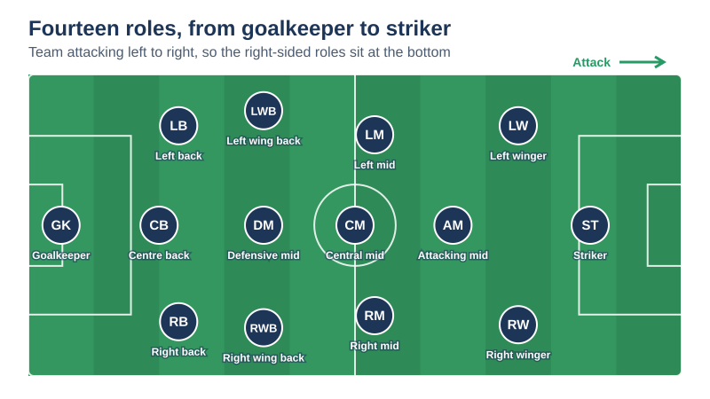
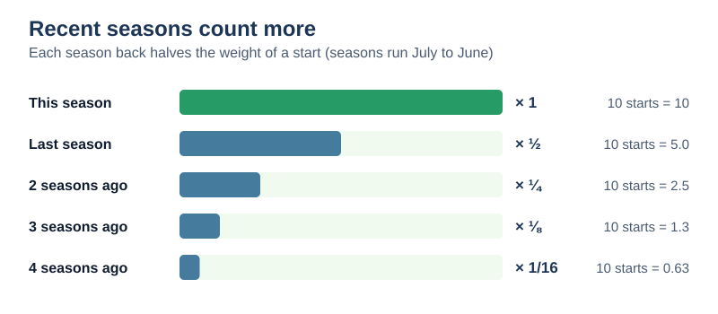

<h2>In short</h2>
<ul>
<li>Every start is assigned one of <strong>14 roles</strong> from the team's formation and the order of the starting eleven.</li>
<li>Starts this season count in full; each season further back counts <strong>half as much</strong>.</li>
<li>The most-played role is the <strong>main position</strong>. Others become <strong>secondary positions</strong> with at least 10% of weighted starts and 3 real starts.</li>
</ul>

## From lineups to roles

For every match with a lineup, we take each team's formation (4-3-3, 3-5-2 and so on) and the order of the starting eleven on the pitch. From those two things we can assign every starter a specific role, such as right back, defensive midfielder or left winger.

<figure class="wiki-figure">

<figcaption>The fourteen roles a start can be assigned to. The generic labels DF, MF and FW are only used when we have no lineups for a player (see below).</figcaption>
</figure>

A few rules keep the data clean:

- **Only starts count.** Substitute appearances are left out, because a player coming on often slots into whatever gap is free.
- **Doubtful lineups are skipped, not guessed.** If a lineup is incomplete, has no formation, or uses a formation we don't recognise, we leave it out. One missing player would shift everyone after them into the wrong role.
- **Club and country count the same.** A start for a national team counts just like a start for a club.

## Recent seasons count more

Players change position over a career: a winger becomes a wing back, a number 10 drops deeper. To keep positions current, every start is weighted by how recent its season is. Seasons run from **July to June**.

<figure class="wiki-figure">

<figcaption>Ten starts at left back three seasons ago are worth about the same as one start there this season.</figcaption>
</figure>

## Main and secondary positions

<dl class="wiki-rules">
<dt>Main position</dt>
<dd>The role with the most weighted starts. If two roles are level, the one with more actual starts wins.</dd>
<dt>Secondary positions</dt>
<dd>Any other role with <strong>at least 10%</strong> of the player's weighted starts <strong>and at least 3</strong> actual starts. Both conditions must hold, so a single emergency start in an unfamiliar role doesn't count.</dd>
</dl>

### Example

A midfielder made 20 starts at central midfield this season and 4 at defensive midfield. Last season they made 16 starts at defensive midfield.

| Role | Real starts | Weighted starts | Share |
|---|---|---|---|
| CM | 20 | 20 | 62.5% |
| DM | 20 | 4 + 8 = 12 | 37.5% |

Both roles have 20 real starts, but CM leads on weighted starts, so CM is the main position and DM is a secondary position.

## Reading a player's page

The **Positions** table on a player page lists the main role and any secondary roles:

- **Starts** is the real number of starts in that role, across all seasons.
- **Share** is the role's share of the *weighted* starts. Because it leans towards the current season, it need not match the raw start counts.

On the pitch graphic, the main position is the **red dot** and secondary positions are **blue**, fading the less often the role is played.

## Players without usable lineups

New signings and players whose matches have no detailed lineup show the position listed by our data source instead. That may be a general label such as <abbr title="Midfielder">MF</abbr> rather than a specific role, and it has no starts or share. Positions are recalculated shortly after new results come in, so these players get proper roles once they start matches with a lineup.

## Where you'll see it on the site

The same main and secondary positions fill the <abbr title="Main position">Pos</abbr> and <abbr title="Secondary position">SecPos</abbr> columns in player tables, such as [Top Players](/top-players). The position filter in those tables matches any of a player's regular positions, main or secondary. See [Abbreviations](/wiki/abbreviations) for every role code.
